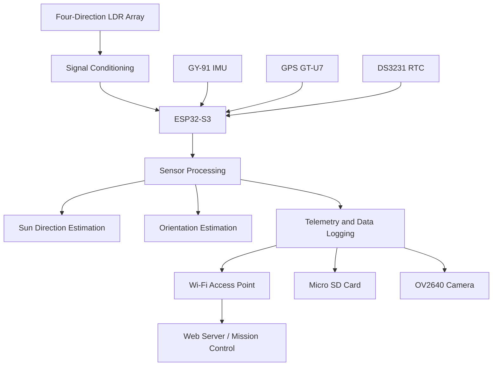

# The Sunset Switch
### 1U CubeSat Sun-Position Sensing Prototype

**Year 2 Team Engineering Project**  
**Institution:** King Mongkut's Institute of Technology Ladkrabang (KMITL)  
**Team:** Group 1

## Overview

The Sunset Switch is a low-cost 1U CubeSat prototype developed to explore the feasibility of implementing satellite-related sensing and telemetry systems using commercially available off-the-shelf (COTS) electronics.

The prototype integrates a four-direction Light-Dependent Resistor (LDR) sensor array to detect changes in light intensity and estimate the direction of the light source. An ESP32-S3 microcontroller processes sensor measurements alongside orientation data from an IMU and positioning data from a GPS module.

The system also features onboard data logging, image storage, and a Wi-Fi-based web dashboard for real-time telemetry monitoring.

The project focuses on developing an integrated CubeSat module through practical electronics design, analog signal conditioning, power regulation, embedded programming, and mechanical prototyping.

## Project Objectives

- Design and develop a functional 1U CubeSat prototype (10 × 10 × 10 cm form-factor concept).
- Develop a four-direction LDR-based sensor system for light-intensity measurement and sun-direction estimation.
- Integrate GPS and IMU sensors for positioning and satellite orientation monitoring.
- Design custom analog amplifier and voltage-regulator circuits.
- Implement onboard data logging and wireless telemetry through an ESP32-S3.
- Develop a web-based Mission Control dashboard for real-time data visualization.

## System Architecture



## Hardware Components

| Component | Model | Function |
|---|---|---|
| Microcontroller | ESP32-S3-WROOM-1 N16R8 | Main processing and wireless communication |
| Light Sensor | LDR × 4 | Four-direction light-intensity detection |
| IMU | GY-91 MPU9250 | Acceleration, angular velocity, and orientation sensing |
| GPS | GT-U7 | Geographic positioning and UTC information |
| Real-Time Clock | DS3231 | Timekeeping |
| Operational Amplifier | LM358N | LDR signal amplification |
| Voltage Regulator | MC34063 | DC-DC voltage conversion |
| Voltage Regulator | LM1084IT-ADJ | Adjustable voltage regulation |
| Camera | OV2640 | Image acquisition and storage |
| Storage | 32 GB Micro SD Card | Telemetry and image storage |
| Power Source | 18650 Li-ion Batteries | Electrical power supply |

## Sensor Subsystem

### 1. Four-Direction LDR Sun Sensor

The sensor subsystem uses four LDRs arranged along the North, South, East, and West directions.

Each sensor measures changes in light intensity through a voltage-divider circuit. The analog signals are amplified using LM358N operational amplifiers before being read by the ESP32-S3 ADC.

Main functions:
- Measure light intensity through four directional sensors.
- Convert analog measurements into digital ADC values (12-bit resolution).
- Apply signal filtering and averaging to reduce noise.
- Analyze the relationship between light intensity and LDR resistance.
- Estimate the direction of the light source using differences between opposing sensors.

The directional calculation uses:

```text
X = East - West
Y = North - South

Angle = arctan(Y / X)
```

The project also explores LDR calibration using experimental measurements and linear regression to characterize sensor response.

### 2. Orientation Monitoring

The GY-91 MPU9250 module provides accelerometer and gyroscope measurements for monitoring the prototype's orientation.

The flight software:
- Reads raw 16-bit gyroscope measurements through I2C.
- Converts angular velocity into physical units.
- Estimates angular displacement using numerical integration (Euler method).
- Applies a deadzone filter to reduce small fluctuations caused by sensor noise.

The orientation measurements are used alongside LDR readings to analyze the light-source direction relative to the module.

### 3. GPS and Timekeeping

The GT-U7 GPS module provides geographic coordinates and UTC information, while the DS3231 RTC maintains system time.

The system incorporates GPS data validation and non-blocking timing logic to support continuous sensor acquisition.

## Analog Electronics and Power Subsystem

The project involves designing and testing custom electronic circuits for sensor signal conditioning and power management.

### Signal Amplifier

An LM358N non-inverting amplifier circuit is used to amplify the LDR sensor signals to a suitable voltage range for the ESP32-S3 ADC.

The amplifier circuit was designed and evaluated through theoretical gain calculations and experimental voltage measurements.

### Power Management

The prototype uses two 18650 lithium-ion cells connected in series, providing a nominal input voltage of approximately 7.4 V.

The power subsystem was designed to provide multiple voltage rails:

| Output | Main Component | Purpose |
|---|---|---|
| 1 V | MC34063 + diode compensation | LDR sensor supply |
| 3.3 V | MC34063 | Low-voltage electronics |
| 5 V | LM1084IT-ADJ | Higher-current components |

Power development involved:
- DC-DC converter design and component selection.
- Voltage-divider calculations and regulator configuration.
- PCB design and fabrication.
- Output voltage measurement and verification.
- Efficiency analysis under different load conditions.

An important engineering challenge was the MC34063 output-current limitation and poor conversion efficiency in the 1 V supply circuit. A diode-compensation approach was tested to obtain the required approximate output voltage, while the 5 V regulator was changed to LM1084IT-ADJ to provide sufficient output current.

## Embedded Software and System Architecture

The embedded software runs on the ESP32-S3 and uses FreeRTOS to distribute system tasks across its dual-core architecture.

### Core 1 – Sensor Acquisition and Communication

- Continuously reads LDR, IMU, GPS, and RTC measurements.
- Calculates light-source direction and orientation.
- Maintains shared telemetry data.
- Runs a Wi-Fi Access Point and HTTP Web Server.
- Provides JSON sensor data to the Mission Control dashboard.

### Core 0 – Data Logging and Imaging

- Controls the OV2640 camera.
- Captures and compresses images into JPEG format.
- Records sensor measurements into CSV files on the Micro SD card.
- Stores captured images with timestamp-based filenames.

A mutex-based synchronization mechanism is used to manage access to shared sensor data between tasks.

## Wireless Communication and Mission Control

The ESP32-S3 operates as a Wi-Fi Access Point, allowing a computer or mobile device to connect directly to the prototype.

The embedded web server provides the following HTTP endpoints:

| Endpoint | Function |
|---|---|
| `/` | Displays the Mission Control dashboard |
| `/readings` | Provides current telemetry in JSON format |
| `/download` | Downloads recorded CSV data |

The dashboard displays live sensor measurements, including light intensity, sun direction, GPS information, and orientation data.

## Data Collection and Analysis

The system records telemetry data to the onboard Micro SD card at 1-second intervals.

Recorded parameters include:
- UTC timestamp.
- LDR measurements and estimated light intensity.
- Sun-direction estimation.
- Accelerometer and gyroscope measurements.
- Satellite orientation (Azimuth).
- GPS positioning information.

Images are also captured periodically and stored separately on the Micro SD card.

The collected data can be used to investigate the relationship between light exposure, LDR response, and module orientation.

## Mechanical Design

The CubeSat structure uses a modular, four-layer 3D-printed frame designed to accommodate the electronic subsystems.

The internal arrangement includes:

1. **Top Layer:** Four LDR sensors and GPS module.
2. **First Layer:** ESP32-S3 mainboard and GPS electronics.
3. **Second Layer:** IMU, RTC, and amplifier circuit.
4. **Third Layer:** Voltage regulators, switch, and heat sink.
5. **Bottom Section:** Lithium-ion battery compartment.

The modular arrangement allows the electronic subsystems to be installed and accessed separately.

## Project Results

The team successfully demonstrated a functional CubeSat prototype integrating light-intensity sensing, orientation monitoring, and a web-based Mission Control interface.

The developed system demonstrated:
- Detection of changes in light intensity using four directional LDR sensors.
- Estimation of light-source direction.
- Real-time orientation and telemetry monitoring.
- Onboard CSV data logging and image storage.
- Wireless data access through an ESP32-S3 Wi-Fi web server.
- Successful integration of a modular 3D-printed structure and electronic subsystems.

Power-conversion experiments also identified limitations in regulator current capacity and conversion efficiency, providing opportunities for further power-system optimization.

## Technologies and Engineering Skills

**Embedded Systems**
- ESP32-S3
- C/C++
- FreeRTOS
- I2C, UART, ADC
- Wi-Fi Access Point and HTTP Web Server

**Electronics**
- Analog Circuit Design
- LM358N Operational Amplifier
- DC-DC Buck Converter
- Voltage Regulation
- PCB Design and Fabrication
- Sensor Signal Conditioning

**Sensors and Data Processing**
- LDR Calibration
- Linear Regression
- Gyroscope Integration
- Sensor Filtering
- GPS Data Validation

**Mechanical Engineering**
- 3D CAD Design
- Modular Mechanical Design
- 3D Printing
- Electronics Integration

## Project Documentation

- **Project Poster:** See `docs/Project_Poster.png`
- **Final Presentation Report:** See `docs/Final_Presentation_Report.pdf`

---

**Project:** The Sunset Switch  
**Institution:** King Mongkut's Institute of Technology Ladkrabang  
**Project Type:** Year 2 Team Engineering Project
